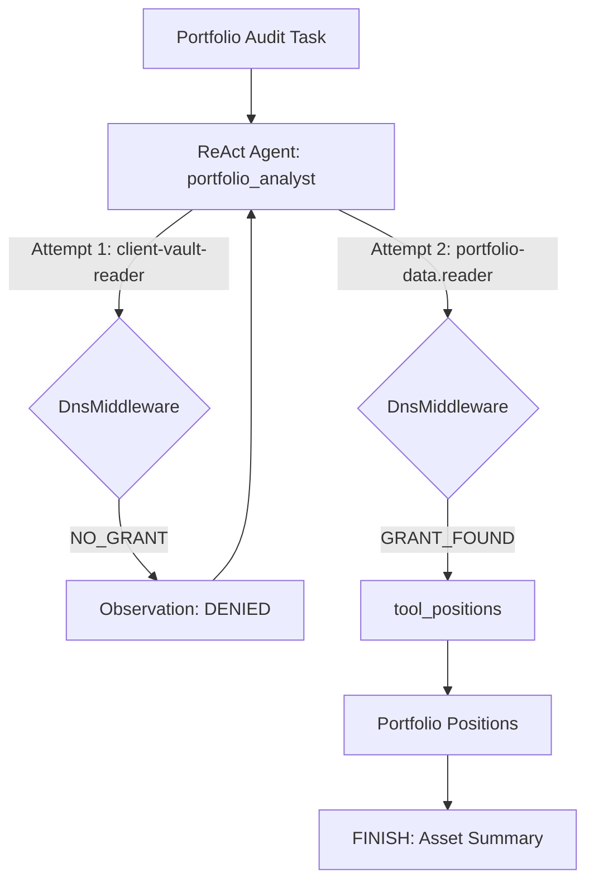

# How to Authorize Tools and Multi-Agent Handoffs with pyagent-dns

When an agent resolves an external capability or tool name, that discovery must never imply permission to execute it. In multi-agent systems, agents frequently execute tasks across departmental boundaries with varying sensitivity levels.

This recipe demonstrates **two-plane tool authorization**:
1. An analyst agent discovers capabilities through a cryptographic `NameRegistry`.
2. A ReAct loop executes guarded tools; calls to ungranted or confidential tools are intercepted and rejected by `DnsMiddleware` before execution.

**Packages used:** `pyagent-dns`, `pyagent-patterns`

---

## Architecture



---

## Declarative Blueprint Configuration

You can declare records and grants directly in a blueprint with the `x-pyagent:dns` extension:

```yaml
api_version: pyagent/v1
metadata:
  name: tool-authorization-demo
  version: 1.0.0
agents:
  portfolio_analyst:
    prompt: "You are a portfolio analyst auditing client positions."
x-pyagent:dns:
  records_files:
    - records.yaml
  grants_files:
    - grants.yaml
  trusted_keys_file: trusted_keys.yaml
  enforcement: required
```

---

## Python Orchestration

```python
import asyncio
from pyagent_dns.blueprint import load_blueprint_dns
from pyagent_dns.middleware import DnsMiddleware
from pyagent_patterns.advanced.react import ReAct
from pyagent_patterns.base import Agent, MockLLM

# 1. Load the DNS bundle
bundle = load_blueprint_dns("blueprint.yaml")
if bundle is not None:
    middleware = DnsMiddleware(bundle.resolver, bundle.graph)

    # 2. Raw tool functions
    raw_tools = {
        "client-vault-reader": lambda q: "SUPER_SECRET_SSN",
        "portfolio-data.reader": lambda q: "AAPL: 100, MSFT: 200",
    }

    # 3. Guard tools with principal chain and declared purpose
    guarded_tools = middleware.guard_tools(
        raw_tools,
        principal_chain=["portfolio_analyst"],
        purpose="portfolio_audit",
    )

    # 4. Run through ReAct
    llm = MockLLM([
        "Thought: check vault.\nAction: client-vault-reader(ACC-1)\n",
        "Thought: vault denied, check positions.\nAction: portfolio-data.reader(ACC-1)\n",
        "Thought: done.\nFINISH: Holdings: AAPL and MSFT.",
    ])
    agent = Agent("portfolio_analyst", llm)
    pattern = ReAct(agent=agent, tools=guarded_tools, max_steps=4)
```

---

## Key Security Properties

- **Zero Unintended Execution**: An unauthorized tool function is never called; the model receives a structured denial observation.
- **Audit Logging**: Every authorization decision is recorded with timestamps, principal chains, and cryptographic record fingerprints.
- **Sub-millisecond Overhead**: Decision checks typically complete in under 0.1 milliseconds.
