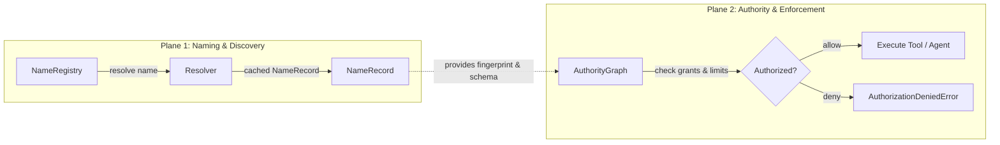

# pyagent-dns

**Cryptographic naming and capability authorization for multi-agent systems** — Ed25519-signed agent and tool name registry paired with a directional authority graph enforcing downward monotonic delegation.

```bash
pip install pyagent-dns                   # Core (NameRegistry, Resolver, AuthorityGraph, Middleware)
pip install pyagent-dns[blueprint]        # + Declarative YAML blueprint extension (x-pyagent:dns)
pip install pyagent-dns[trace]            # + Resolution and decision trace event emission
```

---

## Why pyagent-dns?

In traditional systems, resolving an agent or tool by name often implies permission to execute it. In multi-agent systems with autonomous handoffs, this leads to **confused deputy attacks**, **shadow tool execution**, and **permission escalation**.

`pyagent-dns` enforces the foundational principle: **Naming Is Not Authorization**.



### The Two Planes

1. **Naming Plane (`NameRegistry`, `Resolver`)**:
   - Cryptographic Ed25519 signature verification on every `NameRecord`.
   - Semver-aware version matching and active/deprecated/revoked status checks.
   - Sub-millisecond TTL-cached resolution with explicit invalidation.

2. **Authority Plane (`AuthorityGraph`, `DnsMiddleware`)**:
   - Directional capability grants with strict 8-step evaluation order.
   - Downward monotonic attenuation: delegated tokens can never exceed parent permissions across all 8 dimensions (purpose, actions, data classes, session calls, record count, spend amounts, expiry, delegation depth).
   - Zero-overhead interception: ReAct tool calls and multi-agent supervisor routes are guarded transparently.

---

## Quickstart

```python
from pyagent_dns.authority import Action, AuthorityGraph, CallContext, Grant, ResourceSelector
from pyagent_dns.middleware import DnsMiddleware
from pyagent_dns.records import NameRecord, RecordKind
from pyagent_dns.registry import NameRegistry
from pyagent_dns.resolver import Resolver

# 1. Register a capability
registry = NameRegistry()
registry.register(
    NameRecord(
        name="portfolio-data.reader",
        kind=RecordKind.TOOL,
        version="1.0.0",
        endpoint="internal://tools/positions",
        capabilities=("read_positions",),
        data_classes=("internal",),
        owner="wealth_platform",
    )
)

# 2. Configure authority graph with a scoped grant
graph = AuthorityGraph(registry)
graph.add_grant(
    Grant(
        grant_id="g_analyst_01",
        principal="analyst_agent",
        action=Action.CALL,
        capability="portfolio-data.reader",
        purpose="portfolio_audit",
        resource=ResourceSelector(
            name_scope="portfolio-data.reader",
            data_classes=("internal",),
        ),
    )
)

# 3. Intercept and authorize calls
resolver = Resolver(registry)
middleware = DnsMiddleware(resolver, graph)

decision = middleware.authorize_call(
    principal_chain=["analyst_agent"],
    action=Action.CALL,
    capability="portfolio-data.reader",
    resource=ResourceSelector(name_scope="portfolio-data.reader"),
    context=CallContext(purpose="portfolio_audit"),
)

print(f"Allowed: {decision.allowed}, Reason: {decision.reason_code}")
```

---

## Guarding ReAct Tools

`DnsMiddleware` can guard an entire dictionary of tool functions before handing them to an iterative pattern:

```python
from pyagent_dns.middleware import DnsMiddleware

# Given raw python callables
raw_tools = {
    "vault": lambda q: "SECRET_PASSWORDS",
    "positions": lambda q: "AAPL: 100, MSFT: 200",
}

# Guard the dictionary
guarded_tools = middleware.guard_tools(
    raw_tools,
    principal_chain=["analyst_agent"],
    purpose="portfolio_audit",
)

# Calling an ungranted tool safely returns an observation to the model:
# "Observation: DENIED [NO_GRANT] No covering grant found for principal 'analyst_agent'"
obs = guarded_tools["vault"]("query")
assert "DENIED" in obs
```
